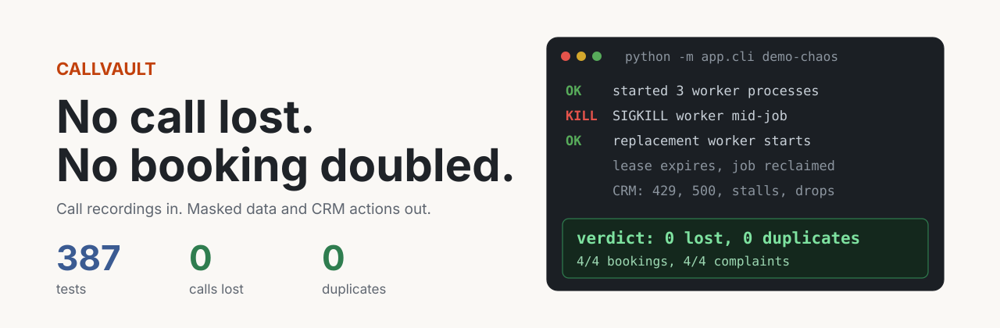
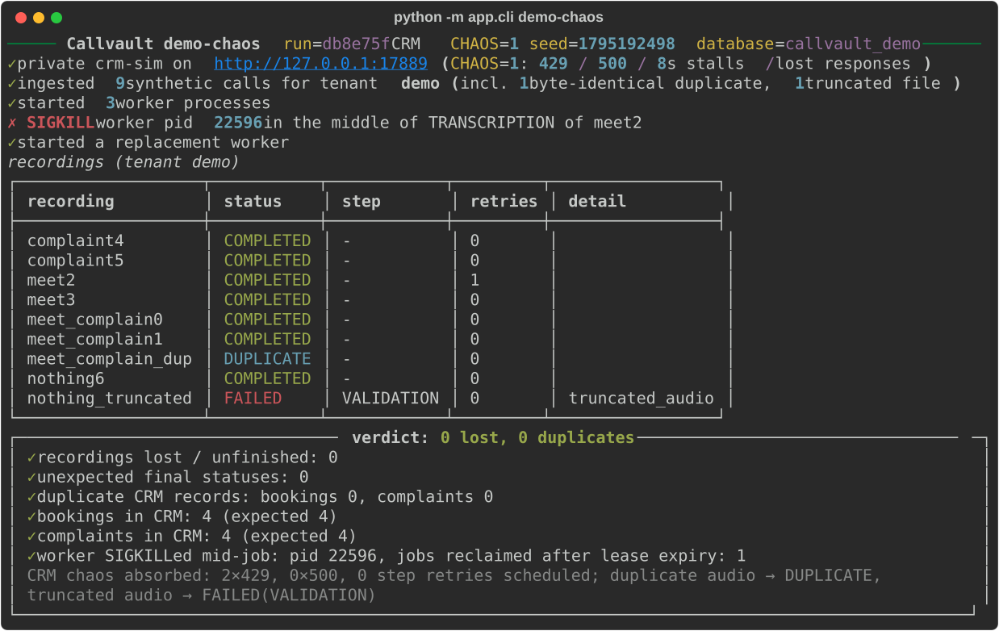
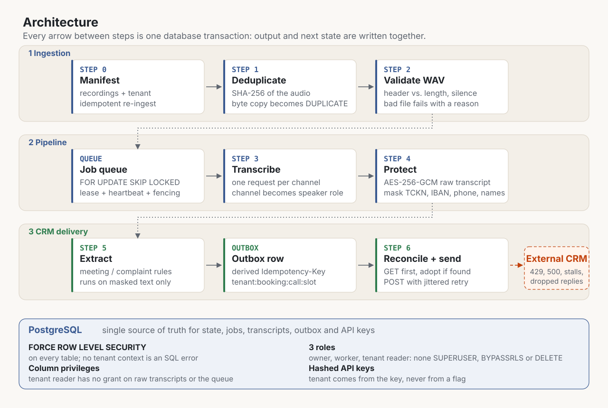
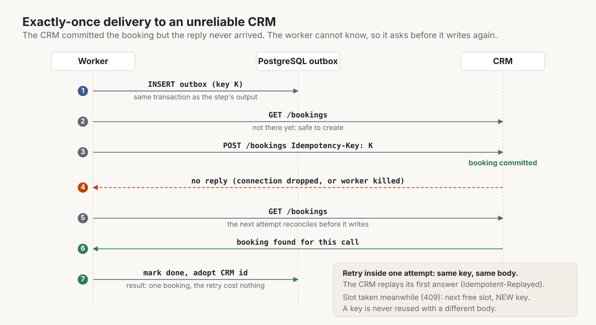
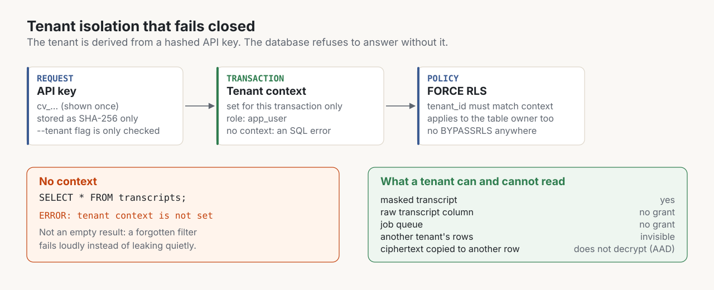
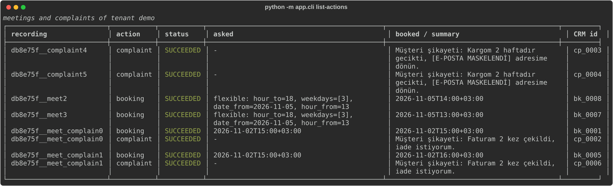
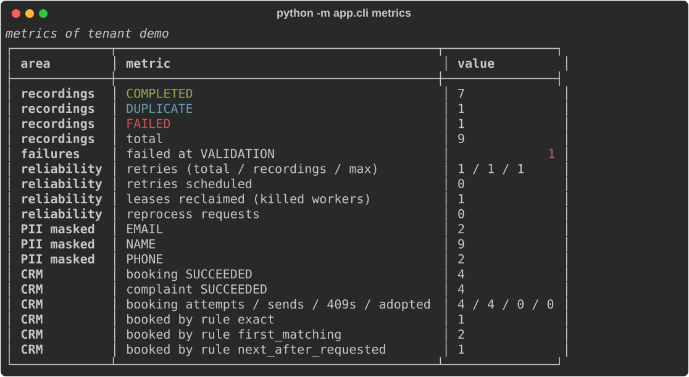

<p align="center">
  
</p>

# Callvault

**A call-recording pipeline that does not lose calls and does not double-book.** It transcribes
Turkish call-center audio, masks personal data, keeps every tenant's data behind PostgreSQL
row-level security, and files meetings and complaints in an unreliable CRM exactly once, even
when workers are killed mid-job.

<p align="center"><a href="#see-it-fail-safely">Demo</a> · <a href="#architecture">Architecture</a> · <a href="#quick-start">Quick start</a> · <a href="docs/DECISIONS.md">36 decisions</a> · <a href="docs/CASE_STUDY.md">Case study</a></p>

It is a personal R&D project on how far reliability, tenant isolation and privacy guarantees can
be pushed in one small system. The reasoning is written down as decision records, and every
guarantee below is backed by a test that tries to break it.

| The promise | How it is kept | Proof |
|---|---|---|
| **No recording is lost** | PostgreSQL job queue (`SKIP LOCKED`), leases, heartbeats and fencing tokens. A killed worker's job is reclaimed. | `tests/test_worker_kill.py` SIGKILLs a real worker process |
| **No duplicate CRM records** | Outbox row, derived `Idempotency-Key`, look-before-write reconciliation, a new key only after a `409`. | `tests/test_crm_chaos.py` runs the pipeline against a CRM that drops replies |
| **Tenants cannot read each other** | `FORCE ROW LEVEL SECURITY` on every table. No tenant context is an SQL error, not an empty result. | 43 penetration tests: SQL injection, header spoofing, role escalation, cross-tenant decryption |
| **Personal data does not leave** | Turkish-aware masking (TCKN and IBAN checksums, Luhn, spoken numbers). Only masked text reaches the CRM; the raw transcript is AES-256-GCM encrypted. | `tests/test_pii.py` (110), `tests/test_numbers_tr.py` (51) |

**387 tests, 0 skipped.** About 4,100 lines of application code, 5 migrations, 36 architecture
decision records.

---

## See it fail safely

```bash
python -m app.cli demo-chaos
```

One command, about 30 seconds, no API key (setup in [Quick start](#quick-start)). It processes synthetic calls with three worker
processes, **SIGKILLs one in the middle of a transcription**, starts a replacement, and then
checks the result against the CRM itself while the CRM throws 429s, 500s, stalls and lost
replies.

<p align="center">
  
</p>

Speech-to-text is scripted in the demo. Everything else (queue, leases, masking, encryption,
CRM client, booking rules, idempotency) is the production code path. The failures are random,
so the retry counts change from run to run. The verdict lines must not.

## Architecture

<p align="center">
  
</p>

Every arrow between steps is one database transaction: a step's output and the job's next
state are written together. A crash between two steps loses nothing, and `reprocess` resumes
at exactly the step that failed. Statuses: `PENDING → VALIDATING → TRANSCRIBING → MASKING →
PROCESSING_CRM → COMPLETED`, or `FAILED` (with step, error code and message), or `DUPLICATE`.

### The hard part: a CRM that lies about failures

<p align="center">
  
</p>

A timeout does not mean the write failed. The CRM may have committed and then dropped the
connection. Retrying blindly books the customer twice. Callvault writes an outbox row with a key
derived from tenant, call and slot, asks the CRM what it already holds before every new
attempt, and only picks a different slot (with a different key) after an explicit `409`.

### Tenant isolation that fails closed

<p align="center">
  
</p>

The tenant is derived from a hashed API key, never from a free-form flag. Application roles
cannot bypass row-level security and cannot `DELETE`. The tenant role has no grant on the raw
transcript column or the queue. Raw transcripts are encrypted with the tenant and recording as
associated data, so a copied ciphertext does not decrypt anywhere else.

## Quick start

Needs Python 3.11+ and a PostgreSQL 16+ you have superuser access to (a throw-away local
instance is fine). No API key is needed for any of the commands below.

```bash
pip install -r requirements.txt
export PGHOST=localhost PGPORT=5432 POSTGRES_ADMIN_PASSWORD=...
export APP_OWNER_PASSWORD=... APP_WORKER_PASSWORD=... APP_USER_PASSWORD=...
export TRANSCRIPT_KEY=$(python -c "import os,base64;print(base64.urlsafe_b64encode(os.urandom(32)).decode())")

python -m app.cli migrate        # roles, row-level security, tables
python -m app.cli demo-chaos     # kill a worker mid-job under CRM chaos
python -m pytest                 # 387 tests; recreates the callvault_test database
```

To process the sample recordings with a worker and a CRM simulator:

```bash
CHAOS=1 python crm-sim/server.py &            # the unreliable CRM, port 8080
export CRM_BASE_URL=http://127.0.0.1:8080
python -m app.cli ingest                      # registers samples/manifest.json
python -m app.cli worker                      # run several in parallel: they never share a job
```

Without a speech-to-text key, every recording still ends in a visible state:

| Sample | What happens |
|---|---|
| `call_01` … `call_04` | `FAILED` at `TRANSCRIPTION` with `stt_not_configured`. Add a key and `reprocess` continues from there. |
| `call_05_duplicate_of_01` | `DUPLICATE` of `call_01` (byte-identical audio, found by SHA-256). |
| `call_06_truncated` | `FAILED` at `VALIDATION`: the header declares 10 s of audio, the file holds 0.1 s. |

The sample audio is synthetic stereo tones. It exercises ingestion, validation and
de-duplication with no real call data. The transcription-to-CRM path is shown by `demo-chaos`,
which scripts the transcripts, and by your own recordings: put Turkish stereo WAVs (agent on
one channel, customer on the other) and a manifest in `samples/` and set a free
[Groq](https://console.groq.com) key as `GROQ_API_KEY` (see `.env.example`).
`STT_PROVIDER=faster_whisper` keeps audio on your machine instead.

A `docker-compose.yml` is included as an alternative way to start PostgreSQL, the CRM
simulator and a worker together. The CI workflow runs the tests and the chaos demo against a PostgreSQL service on every push.

## Use it as a tenant

```bash
python -m app.cli issue-key --tenant harbor     # printed once
export CALLVAULT_API_KEY=cv_...
python -m app.cli list-recordings
python -m app.cli get-transcript --recording-id call_01
python -m app.cli list-actions
python -m app.cli metrics
```

`list-recordings --recording-id ID --events` prints the full history of one recording: every
claim, retry, lease takeover and step. A `--tenant` that does not match the key is refused.

A masked transcript from the demo tenant:

```text
Temsilci: Harbor müşteri hizmetleri, ben [İSİM MASKELENDİ], size nasıl yardımcı olabilirim?
Müşteri: Merhaba, adım [İSİM MASKELENDİ], numaram [TELEFON MASKELENDİ]. Faturam 2 kez çekildi, iade istiyorum. Bir de ekibinizle toplantı yapmak istiyorum, pazartesi saat 15'te olur mu?
```

<p align="center">
  
  
</p>

Both calls asked for Monday 15:00. The slot exists once, so the second call to reach the CRM
got the next free slot. Which call wins depends on worker timing, not on call order (a known
limitation, see below).

### Reprocess, remask

```bash
python -m app.cli reprocess --all-failed
```

Each recording resumes at the step that failed; earlier steps keep their stored results and are
not run again, and the command says so:

```text
requeued harbor/call_04 at CRM (status PROCESSING_CRM); kept, not re-run: VALIDATION, TRANSCRIPTION, MASKING
```

When the masking rules improve, `remask` re-masks completed recordings from the encrypted raw
transcript, scrubs the stored copies, and lists the CRM records that were created with the old
text so someone can correct them there. It never calls the CRM.

## Breaking things on purpose

| What you do | What you should see |
|---|---|
| Set a wrong `GROQ_API_KEY`, restart the worker | Recordings go to `FAILED` at `TRANSCRIPTION` with `stt_auth_error` (key masked as `***`). Fix the key, `reprocess --all-failed`: they continue from `TRANSCRIPTION`. |
| `kill -9` a worker process mid-job | The 60 s lease expires and another worker takes the job over; `--events` shows `lease_reclaimed`. Nothing is lost or done twice. |
| CRM simulator with `CHAOS=1` (default) | 429, 500, 8 s stalls and lost replies are retried with backoff and jitter, with the same key and body. |
| Re-run everything, or wipe the database but keep the CRM | Existing bookings and complaints are found and adopted, not created again. |

## Decisions and reasoning

The interesting part of this project is why, not what. Each decision is an Architecture Decision
Record with context, the alternatives that were rejected, and when to revisit it:

- [`docs/DECISIONS.md`](docs/DECISIONS.md): 36 ADRs (STT provider, row-level security vs. schema-per-tenant, queue in PostgreSQL vs. a broker, checksum-based PII policy, idempotency design, lease and fencing).
- [`docs/RESEARCH_AND_LITERATURE.md`](docs/RESEARCH_AND_LITERATURE.md): the threat model behind them, written as attacks with a defense and the remaining risk each.
- [`docs/CASE_STUDY.md`](docs/CASE_STUDY.md): the story of the project in plain language.

The ADRs and the research notes are in Turkish; this README and the case study are in English.

## Project layout

```text
app/
  cli.py            operator + tenant commands, Rich output
  queue.py          job queue and state machine (claim, lease, fence, retry, reprocess)
  worker.py         worker loop, heartbeats
  steps.py          VALIDATION / TRANSCRIPTION / MASKING handlers
  crm_step.py       PROCESSING_CRM: outbox, reconciliation, 409 handling
  crm.py            CRM HTTP client (backoff + jitter, same key and body on retry)
  booking.py timeparse_tr.py   slot rules, Turkish time expressions
  extraction.py     meeting / complaint detection on masked text
  stt.py audio.py   Groq + faster-whisper providers, channel split, speaker roles
  pii.py numbers_tr.py names_tr.py   Turkish PII masking
  crypto.py         AES-256-GCM for raw transcripts
  tenant_auth.py tenant_api.py       API-key auth and the tenant read side
  remask.py demo.py migrate.py ingest.py db.py config.py errors.py validation.py
migrations/         001 schema · 002 RLS · 003 transcripts · 004 CRM · 005 API keys
tests/              387 tests (RLS, pen-test, PII, STT, queue, CRM, chaos, worker kill, CLI)
crm-sim/            dependency-free CRM simulator with failure injection
samples/            synthetic stereo tones: ingest, validation, de-duplication
scripts/            build_diagrams.py, generate_assets.py, make_samples.py
docs/               ADRs, threat model, case study, figures
```

## Tests

```bash
python -m pytest
```

| Area | Tests |
|---|---:|
| Personal-data masking (Turkish) | 110 |
| Spoken-number normalisation | 51 |
| Penetration tests (SQL injection, spoofing, escalation, cross-tenant decryption) | 43 |
| STT providers and failure classes | 38 |
| Row-level security | 24 |
| Time parsing, booking rules, extraction | 39 |
| Queue, pipeline, CRM client, CRM pipeline, remask, CLI, validation | 80 |
| Real `CHAOS=1` CRM run with 3 parallel workers, real worker SIGKILL | 2 |

## Known limitations

These are real, and they are written down because a project that hides them is harder to trust.

- **Name masking is rules and lists, not a trained NER model.** A name with no context (not in
  the list, not answering a name question, no "Bey/Hanım") can still pass. The next step is a
  Turkish NER model as a second layer (ADR-36, "Revisit if").
- **Meeting and complaint extraction is rule-based**, deterministic and local, not an LLM.
- **When two calls want the same slot, which one gets it depends on worker timing**, not on call
  order.
- **There is no HTTP API.** The tenant interface is the CLI.
- **Audio goes to a third party** (Groq) for transcription by default. `faster-whisper` runs
  behind the same interface to keep audio local.
- **The CRM simulator is mine, not a real CRM.** It reproduces the failure modes the design
  defends against (rate limits, 5xx, stalls, dropped replies); real CRMs add others.
- **Not load tested.** The queue design (`SKIP LOCKED`) is a known pattern for moderate volume;
  no throughput numbers are claimed.

What running it on real call audio taught me, all fixed with tests: Whisper writes spoken
e-mail addresses without an `@`, so masking missed them; the words "yüz yüze" and "bu yüzden"
were read as the number 100; Whisper invents subtitle text on silence; HTTP 429 used up retry
attempts that should have been waited out. See ADR-22, ADR-35 and ADR-36.

### Data that already left the system

`remask` repairs everything Callvault stores. It cannot repair a CRM record created before a
masking fix. The design choice that limits the damage is that only masked text is ever sent to
the CRM. Against a real CRM the path would be: `remask` lists the affected CRM ids; each one is
corrected through the CRM's API with an idempotency key derived from the id and a hash of the
new text; the CRM's own history is purged through a data-erasure request; the correction is
recorded in `recording_events`. That last mile is not implemented because the simulator has no
update endpoint.
